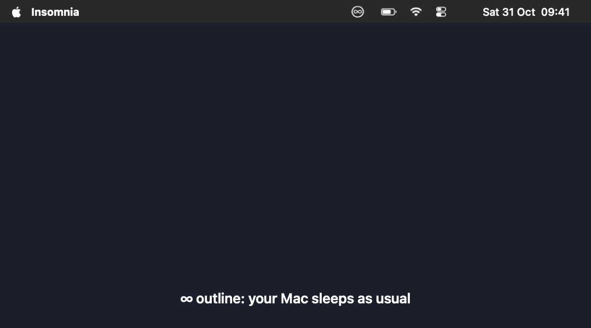

# Insomnia

Keep your Mac awake from the menu bar — even with the lid closed, and without it locking.
Made for remote access, long builds and AI agents that need to see the screen.



- **Click**: menu — stay awake for a duration or while an app runs, black screen, settings.
- **Right click** or **⌃⌥⌘I**: toggle between awake (∞ filled) and normal sleep (∞ outline).

While awake, closing the lid turns the screen and keyboard backlight off instead of sleeping.
The Mac doesn't lock, stays reachable and screenshots keep working. Opening the lid brings
the previous brightness back.

Available in English, French, Spanish, German, Italian, Portuguese, Japanese, Korean and
Simplified Chinese, following your Mac's language.

## Safety

Sleep goes back to normal on its own:

- when the battery drops below a threshold (menu, 15 % by default, or never);
- when the Mac gets too hot (critical heat, or serious heat with the lid closed);
- when Insomnia quits.

Optionally, the Mac locks when the lid is reopened (menu → Lock When Lid Opens).

## Install

Requires macOS 14 or later.

**Download:** get `Insomnia.zip` from the [latest release](https://github.com/pdossodautais/insomnia/releases/latest)
(universal app, not notarized: see the release notes to open it).

**Build from source:**

```sh
git clone https://github.com/pdossodautais/insomnia.git
cd insomnia
sh build.sh
```

This builds `Insomnia.app` (offering to install the Xcode Command Line Tools if they're
missing), installs it in `/Applications`, links the `insomnia` command and opens the app.
The command goes in `/opt/homebrew/bin`, `/usr/local/bin` or `~/.local/bin`; the script
tells you if that folder needs adding to your PATH.

On first launch, Insomnia offers to open at login, then to add `/etc/sudoers.d/insomnia`:
a rule that allows only `pmset -a disablesleep 0|1` without a password (macOS asks for your
administrator password once).

### Sharing the app

`build.sh` also leaves `build/Insomnia.zip`. The app isn't notarized by Apple, so on another
Mac, unzip it into `/Applications` and clear the download flag before opening it:

```sh
xattr -dr com.apple.quarantine /Applications/Insomnia.app
```

## Command line

```sh
insomnia on            # stay awake until turned off
insomnia on 2h         # for a duration: 45m, 2h, or minutes
insomnia run npm test  # while a command runs (returns its exit code)
insomnia off           # back to normal sleep
insomnia dim           # black screen without locking (display sleep when not awake)
insomnia wake          # restore the screen
insomnia status        # prints "awake" or "normal"
```

The command opens the app if needed. It never overrides an awake mode turned on by hand.

> **Note:** the command talks to the app through macOS distributed notifications, which any
> program running under your account can send. Such a program could therefore turn the
> awake mode on or off, or black out and restore the screen. It can't do anything else:
> sleep itself is only changed through the sudoers rule above.

## Uninstall

```sh
rm -rf /Applications/Insomnia.app "$(command -v insomnia)"
sudo rm /etc/sudoers.d/insomnia
```

## Project

- `main.swift`: the app and the command-line tool.
- `Resources/`: app icon and translations. English is built in; to add a language, copy a
  `<lang>.lproj/Localizable.strings` folder, translate it and rebuild.
- `tools/make-icon.swift`: regenerates `Resources/AppIcon.icns`.
- `tools/make-demo.swift`: regenerates `docs/demo.gif`.
- `build.sh`: build and install.

## License

MIT — see [LICENSE](LICENSE).

## Limits

Screen and keyboard brightness rely on private Apple frameworks (DisplayServices,
CoreBrightness) that a macOS update could break; sleep control would keep working.
